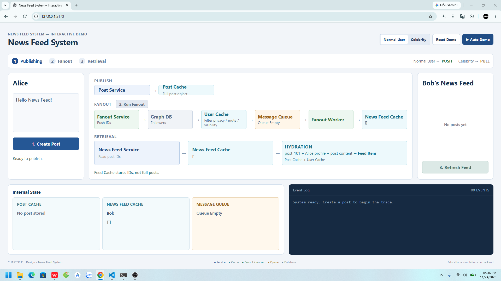
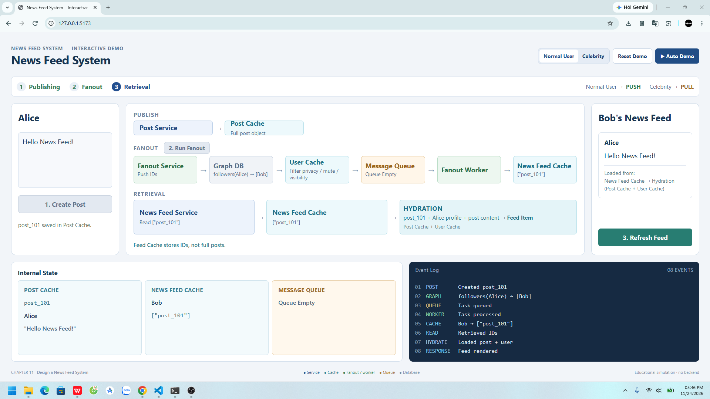

# News Feed System – Interactive Architecture Demo

## Thông tin sinh viên

- **Họ và tên:** Lương Trọng Nghĩa
- **MSSV:** 087206014598
- **Chủ đề:** Chapter 11 – Design a News Feed System

## Giới thiệu

**News Feed System – Interactive Architecture Demo** là ứng dụng mô phỏng trực quan quy trình hoạt động của hệ thống bảng tin, phục vụ việc học và thuyết trình về thiết kế hệ thống.

Demo sử dụng hai nhân vật: **Alice** đăng bài viết và **Bob** theo dõi Alice. Người trình bày có thể thực hiện riêng từng giai đoạn để quan sát cách bài viết được lưu trữ, phân phối và hiển thị trên bảng tin của Bob.

Ứng dụng minh họa ba luồng chính:

1. **Publishing:** tạo bài viết và lưu nội dung đầy đủ vào Post Cache.
2. **Fanout:** tìm người theo dõi, đưa tác vụ vào hàng đợi và phân phối ID bài viết vào News Feed Cache.
3. **Retrieval và Hydration:** đọc danh sách ID, lấy dữ liệu bài viết và người dùng để tạo mục tin hoàn chỉnh.

Đây là **mô phỏng phục vụ học tập**, không phải mạng xã hội thực tế. Các service, cache, cơ sở dữ liệu đồ thị và hàng đợi đều được mô phỏng bằng state trong trình duyệt.

## Video demo

[▶ Xem video demo News Feed System](docs/videos/demo.mp4)

Video minh họa quá trình thao tác và hoạt động của ứng dụng mô phỏng.

## Hình ảnh demo

### Trạng thái ban đầu

Alice chuẩn bị đăng bài; bảng tin của Bob, các cache bài viết và hàng đợi chưa có dữ liệu.



### Sau khi hoàn thành ba bước

Post Cache chứa bài viết đầy đủ, News Feed Cache của Bob chỉ chứa `["post_101"]`, còn Bob đã nhận được bài viết sau bước Hydration. Event Log hiển thị các sự kiện đã xử lý.



## Công nghệ sử dụng

| Thành phần | Công nghệ |
| --- | --- |
| Giao diện | React |
| Ngôn ngữ | TypeScript |
| Công cụ phát triển và build | Vite |
| Định dạng giao diện | CSS thuần |
| Dữ liệu mô phỏng | React state và các đối tượng trong bộ nhớ |

Ứng dụng không cần backend, database server, tài khoản đăng nhập, biến môi trường hoặc API bên ngoài. Sau khi cài đặt dependencies, demo có thể chạy trên localhost khi không có Internet.

## Cài đặt và chạy

**Yêu cầu:** Node.js 22.12 trở lên; khuyến nghị Node.js 24 trở lên để chạy cả bộ kiểm thử.

Mở terminal tại thư mục dự án có file `package.json`, sau đó chạy:

```bash
npm install
npm run dev
```

Mở địa chỉ localhost được Vite hiển thị trong terminal, thường là `http://127.0.0.1:5173`. Nếu cổng đang được sử dụng, Vite sẽ thông báo cổng khác.

Build và xem bản production:

```bash
npm run build
npm run preview
```

Chạy bộ kiểm thử logic mô phỏng:

```bash
npm test
```

Nếu PowerShell chặn lệnh `npm`, có thể thay bằng `npm.cmd`, ví dụ `npm.cmd run dev`.

## Hướng dẫn sử dụng demo

### Bước 1 – Create Post

Chọn **Normal User**, nhấn **Reset Demo**, giữ nội dung mặc định `Hello News Feed!`, rồi nhấn **1. Create Post**.

Luồng xử lý:

```text
Alice → Post Service → Post Cache
```

Hệ thống tạo bài viết có ID cố định `post_101` và lưu đối tượng đầy đủ:

```ts
{
  id: "post_101",
  authorId: "user_A",
  authorName: "Alice",
  content: "Hello News Feed!"
}
```

**Kết quả:** Post Cache đã có nội dung, nhưng Bob vẫn thấy **No posts yet**. Việc tạo bài viết chưa đồng nghĩa với việc phân phối bài vào bảng tin.

### Bước 2 – Run Fanout

Nhấn **2. Run Fanout** cạnh hàng FANOUT.

```text
Fanout Service → Graph DB → User Cache
→ Message Queue → Fanout Worker → News Feed Cache
```

- **Graph DB:** tra cứu danh sách người theo dõi Alice, trong demo là Bob.
- **User Cache:** minh họa bước lọc người nhận. Nhãn `Filter privacy / mute / visibility` mang tính giáo dục; logic hiện tại chỉ kiểm tra người nhận có trong User Cache.
- **Message Queue:** tạm chứa tác vụ gồm `postId` và `targetUserId`.
- **Fanout Worker:** xử lý tác vụ, ghi ID bài viết vào cache feed của người nhận, rồi xóa tác vụ khỏi hàng đợi.

Ví dụ tác vụ:

```ts
{
  postId: "post_101",
  targetUserId: "user_B"
}
```

Sau khi xử lý:

```ts
newsFeedCache["user_B"] = ["post_101"];
```

**Kết quả:** Message Queue trở về **Queue Empty**. News Feed Cache của Bob đã có ID, nhưng Bob vẫn chưa thấy bài viết vì chưa tải lại feed.

### Bước 3 – Refresh Feed

Nhấn **3. Refresh Feed** tại bảng tin của Bob.

```text
Bob → News Feed Service → News Feed Cache → Hydration
```

News Feed Service đọc `["post_101"]`. Bước Hydration sử dụng dữ liệu bài viết trong Post Cache và hồ sơ người dùng trong User Cache để hiển thị mục tin:

```text
post_101 + Alice profile + post content → Feed Item
```

**Kết quả:** Bob nhìn thấy bài viết của Alice với nội dung `Hello News Feed!`.

### Các nút điều khiển khác

| Điều khiển | Chức năng |
| --- | --- |
| Normal User | Chọn mô phỏng phân phối ID khi đăng bài – Push / Fanout on Write |
| Celebrity | Chọn mô phỏng ghép bài khi đọc – Pull / Fanout on Read |
| Auto Demo | Đặt lại dữ liệu và tự động chạy ba giai đoạn |
| Stop Demo | Dừng lượt chạy tự động và đặt lại dữ liệu |
| Reset Demo | Xóa dữ liệu của lượt chạy, bảng tin, hàng đợi, log và các highlight |

Các nút thủ công không tự chuyển sang giai đoạn tiếp theo, giúp người trình bày dừng lại để giải thích. Chuyển chế độ cũng đặt lại dữ liệu; các nút chuyển chế độ bị khóa khi một giai đoạn đang chạy.

## Các kiến thức thiết kế hệ thống được minh họa

### Vì sao Feed Cache chỉ lưu ID?

News Feed Cache lưu danh sách tham chiếu đến bài viết thay vì sao chép toàn bộ nội dung cho từng người theo dõi. Cách này giúp giảm bộ nhớ và tránh phải cập nhật nhiều bản sao nội dung khi bài viết thay đổi. Nội dung đầy đủ được lấy khi đọc feed.

### Vai trò của Message Queue và Fanout Worker

Hàng đợi tách bước đăng bài khỏi việc phân phối đến nhiều người nhận, đồng thời minh họa cách hấp thụ các đợt tăng tải. Worker xử lý các tác vụ phân phối một cách độc lập với bước tạo bài.

### Hydration là gì?

Hydration là bước bổ sung dữ liệu đầy đủ cho các ID trong feed: lấy nội dung từ Post Cache và thông tin tác giả từ User Cache để tạo mục tin có thể hiển thị.

### Hybrid Fanout

| Loại người dùng | Chiến lược | Hành vi trong demo |
| --- | --- | --- |
| Người dùng thông thường | **Push – Fanout on Write** | Đưa ID bài của Alice vào News Feed Cache của Bob khi chạy fanout |
| Người nổi tiếng | **Pull – Fanout on Read** | Bỏ qua việc ghi vào cache của từng người theo dõi; ghép bài Celebrity_X khi Bob đọc feed |

Trong chế độ Celebrity, cache feed của Bob vẫn là `[]` nhưng Bob vẫn có thể nhận bài sau khi refresh. Demo không tạo hàng triệu người dùng hay hàng triệu mục cache thật.

## Cấu trúc mã nguồn

```text
src/
├── App.tsx                       # Điều phối các bước và animation
├── main.tsx                      # Khởi tạo ứng dụng React
├── styles.css                    # Giao diện và bố cục trình chiếu
├── components/
│   ├── ArchitectureDiagram.tsx   # Sơ đồ Publishing, Fanout, Retrieval
│   ├── PhoneFeed.tsx             # Khung Alice và bảng tin Bob
│   ├── CacheInspector.tsx        # Ba thẻ Internal State
│   ├── EventLog.tsx              # Nhật ký sự kiện
│   └── DemoControls.tsx          # Chế độ và nút điều khiển
├── engine/
│   └── simulation.ts             # Logic chuyển trạng thái mô phỏng
├── data/
│   └── demoData.ts               # Người dùng, graph và state ban đầu
└── types/
    └── index.ts                  # Các kiểu dữ liệu TypeScript
tests/
└── simulation.test.ts            # Kiểm thử logic
docs/images/                     # Ảnh chụp demo
```

## Gợi ý trình bày trong 60–90 giây

1. **Giới thiệu:** “Demo mô phỏng cách một bài viết từ Alice xuất hiện trên bảng tin của Bob.”
2. **Create Post:** “Nội dung được lưu vào Post Cache. Bob chưa nhận được bài.”
3. **Run Fanout:** “Hệ thống tìm người theo dõi, tạo tác vụ trong queue và dùng worker phân phối ID.” Chỉ vào News Feed Cache để nhấn mạnh dữ liệu chỉ là `["post_101"]`.
4. **Refresh Feed:** “Khi Bob đọc bảng tin, hệ thống lấy ID và hydrate bằng dữ liệu user cùng nội dung bài viết.”
5. **Celebrity:** “Với người có rất nhiều người theo dõi, hệ thống bỏ qua việc đẩy tới từng feed và ghép bài khi đọc. Đây là ý tưởng Hybrid Fanout.”

## Lưu ý khi trình chiếu

- Cài dependencies và chạy thử trước buổi thuyết trình.
- Giữ terminal chạy Vite trong suốt buổi demo.
- Dùng mức zoom trình duyệt 100%; ưu tiên độ phân giải 1920×1080 hoặc 1366×768.
- Kiểm tra cả Normal User, Celebrity, Auto Demo và Reset Demo.
- Nhấn Reset Demo trước khi bắt đầu; tải lại trang sẽ mất dữ liệu mô phỏng.
- Nếu nút bị khóa, chờ giai đoạn hiện tại kết thúc hoặc hoàn thành bước trước đó.

## Phạm vi và giới hạn

Mỗi lượt chạy có một bài viết với ID cố định và một người nhận thông thường. Ứng dụng không triển khai lưu trữ bền vững, xếp hạng feed, phân mảnh dữ liệu, xử lý lỗi phân tán hoặc hệ thống retry thực tế. Các thành phần trong sơ đồ dùng để giải thích kiến trúc; không có Graph DB, Redis hay hệ thống hàng đợi thật đang chạy phía sau.
